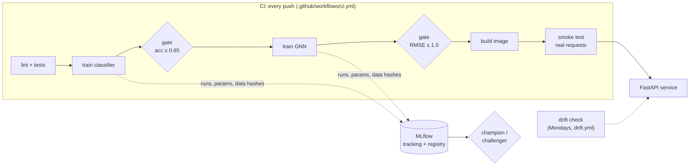

# transformer-mlops

An MLOps pipeline built from scratch, carrying two models through the same
path: train → quality gate → model registry → container image → smoke test →
API → monitoring. The main model predicts the water solubility of a molecule
from its structure; the second is a small text classifier on synthetic data
that exercises the pipeline end to end.

This is a portfolio project. The solubility model is trained on public data
and is not meant to compete with established tools; the point is a pipeline
in which every served model is gated, versioned and traceable.

## At a glance

| | Solubility GNN | Text classifier |
|---|---|---|
| Task | log S (log mol/L) from a SMILES string | sentence → `methods` / `results` / `background` |
| Model | 2-layer graph convolutional network + 8 descriptors | 2-layer, 4-head transformer encoder (~65k params) |
| Data | AqSolDB organic subset (7,843 train), ESOL val/test | 100% synthetic, template-generated |
| Headline result | scaffold-split test RMSE **0.795** (random split 0.644) | test accuracy 100% (synthetic, so easy) |
| CI quality gate | RMSE ≤ 1.0 | accuracy ≥ 85% |
| Endpoint | `POST /predict-solubility` | `POST /predict` |

CI (lint, 26 tests, both models trained and gated, image built and
smoke-tested) takes about 8 minutes on a GitHub runner.

## Run it

```bash
scripts/demo.sh
```

Trains both models if their artifacts are missing (~4 min, mostly the GNN),
builds the Docker image and serves it on `localhost:8000`. Needs Docker and a
Python environment with the requirements (below). Then:

```bash
curl -X POST localhost:8000/predict-solubility \
  -H 'Content-Type: application/json' -d '{"smiles":"CC(=O)Oc1ccccc1C(=O)O"}'
# {"smiles":"CC(=O)Oc1ccccc1C(=O)O","predicted_log_solubility":-1.86,
#  "nearest_train_similarity":1.0,"warnings":[]}     (aspirin; measured -1.72)

curl -X POST localhost:8000/predict \
  -H 'Content-Type: application/json' -d '{"text":"we trained the model for ten epochs"}'
# {"label":"methods","confidence":0.9999,...}
```

`GET /health` returns `{"status":"ok"}`. An invalid SMILES returns 422.

Environment setup:

```bash
python -m venv .venv && source .venv/bin/activate
pip install torch --index-url https://download.pytorch.org/whl/cpu
pip install -r requirements.txt
```

## Pipeline



- **Quality gates.** Each model is re-evaluated from its saved artifact and the
  build fails if it misses its bar.
- **Registry.** Every training run is logged to MLflow with its settings,
  scores, `git_commit`, `git_dirty`, the variant name and SHA-256 hashes of
  the data files. A new model becomes `champion` only if it beats the current
  champion's validation score; otherwise it is kept as `challenger`.
- **Smoke test.** CI starts the built image and sends real requests to
  `/health`, `/predict` and `/predict-solubility`.
- **MLflow upload.** The last CI step uploads the tracking store as a run
  artifact, even when an earlier step failed.
- **Orchestration.** `flows/gnn_flow.py` runs the GNN pipeline (data → train →
  evaluate → register) as a Prefect flow with retries, using the served
  model's settings by default.
- **Monitoring.** `drift.yml` runs `scripts/drift_check.py` every Monday
  06:00 UTC (or on demand): it re-scores the classifier on fresh data and
  fails if accuracy drops by more than 3 points. Since the data is synthetic,
  this exercises the monitoring loop rather than watching real traffic.

## The solubility model

A molecule arrives as a SMILES string. RDKit turns it into a graph (atoms =
nodes, bonds = edges, with atom and bond features). Two message-passing layers
with bond-gated messages update each atom from its neighbours; mean, sum and
max pooling combine the atoms into one vector; eight whole-molecule RDKit
descriptors (logP, molecular weight, rotatable bonds, aromatic fraction, TPSA,
H-bond donors and acceptors, ring count) join it before the output layers.
Plain PyTorch, no graph library. Code in `src/gnn/`.

### Evaluation

The headline number uses a **scaffold split**: molecules are grouped by
Bemis–Murcko scaffold (their ring systems), and no scaffold is shared between
train, validation and test, so test molecules have cores the model never saw.
A random-split model is trained alongside for contrast; it always looks
better, because near-duplicates land on both sides.

Validation and test are always ESOL (MoleculeNet, 1,128 compounds), so
every number below is on the same molecules. One split's RMSE moves by about
±0.08 with the split seed, so model choices were made over five seeds.

| Model (scaffold test RMSE, log units) | Seed 42 split | 5 split seeds, mean |
|---|---|---|
| Starting point: GCN, mean pooling, trained on ESOL | 1.174 | 1.077 ± 0.086 |
| + mean/sum/max pooling + descriptors, trained on ESOL | 0.929 | 0.809 |
| Same, trained on AqSolDB organic subset (served) | **0.795** | 0.768 |

Training on AqSolDB was better on 4 of 5 splits. The gain is larger on
chemistry ESOL lacks: on AqSolDB's own held-out scaffolds (758 compounds not
in ESOL), RMSE was about 1.03–1.12 for the AqSolDB model against 1.33–1.36 for
the ESOL-trained one.

For scale: compounds that AqSolDB lists from more than one source disagree by
0.52 log units (RMS), a rough floor on any model trained on this kind of data.

### Applicability-domain warnings

Every prediction says how far the input is from the training data
(`src/gnn/domain.py`):

- **Hard warnings** for an element never seen in training, several fragments
  (a salt or mixture), no carbon, a heavy-atom count outside the training
  range, or a descriptor more than 5 standard deviations from the training
  mean. The value is still returned but should be ignored.
- **A soft warning** when the nearest training molecule has Tanimoto
  similarity below 0.3 (Morgan fingerprints, radius 2).
  `nearest_train_similarity` reports that value.

The soft warning works on average, not per molecule: over five splits
(measured with the ESOL-trained model) it
flagged about 28% of test molecules, whose RMSE averaged 0.98 against 0.74 for
the rest, but its correlation with an individual error is weak (rank
correlation −0.1 to −0.25).

### Design decisions

- **Scaffold split as the headline.** It is closer to meeting a new compound
  series than a random split, which flatters the model by roughly 20–30%.
- **AqSolDB for training, ESOL for testing.** AqSolDB (9,982 compounds, CC0)
  contains every ESOL compound, so ESOL validation/test molecules, and for the
  scaffold split their scaffolds, are removed from it by InChIKey before
  training. Only the organic subset is used (one fragment, contains carbon,
  only C N O F P S Cl Br I); training on all of AqSolDB did not help.
- **Descriptor clipping.** Standardized descriptors are clipped to ±5 SD
  (`DESC_CLIP` in `src/gnn/model.py`). RDKit counts 264 rings for
  γ-cyclodextrin, and before the clip that one value produced a prediction of
  log S +106.
- **Tried and dropped.** Deeper networks with residual connections (no gain);
  retuning hidden size, depth, epochs and dropout for the larger data set (all
  within noise); a 5-model ensemble's spread as a per-prediction uncertainty
  (it ranked errors poorly, Spearman +0.06 to +0.26, for ~0.02 RMSE gain at 5×
  the training cost).
- **Gate at 1.0, not tighter.** Training is not bit-for-bit repeatable (two
  seed-42 runs scored 0.795 and 0.809), so the gate leaves room for that noise
  while still failing a broken or badly regressed model.

### Limitations

- Structure only: no melting point, crystal form, pH or temperature, so
  solid-state effects (purines are among the worst errors) are invisible.
- Public data mixes labs and methods; it is not the buffered pH 7.4 solubility
  most drug projects measure.
- Neutral, single-component organic molecules only; anything else gets a
  warning.
- No calibrated per-molecule error bar; the typical error is ~0.8 log units, a
  factor of about 6.
- Not benchmarked against established tools or a fingerprint random forest.

## Training and tracking commands

```bash
# Solubility GNN, served settings (scaffold model + random-split contrast + registry gate)
python src/gnn/train.py --epochs 100 --pool mean_sum_max --descriptors \
  --dataset aqsoldb-organic --variant msm-desc-aqsoldb
python src/gnn/evaluate.py --max-rmse 1.0

# Options (defaults keep the original baseline: mean pooling, ESOL, no descriptors)
#   --pool {mean,mean_sum_max}   --descriptors   --residual (pair with --num-layers 4)
#   --dataset {esol,aqsoldb-organic}   --variant NAME   --seed N   --no-mlflow

# Same pipeline as a Prefect flow (defaults to the served settings)
python flows/gnn_flow.py

# Text classifier
python src/train.py --epochs 10
python src/evaluate.py --min-accuracy 0.85

# Browse runs and the registry ("esol-gnn", champion/challenger aliases)
mlflow ui --backend-store-uri sqlite:///mlflow.db --port 5000

uvicorn src.serve:app --port 8000   # serve without Docker
```

On a machine whose proxy variables break Prefect's local server startup, run
the flow with them unset: `env -u http_proxy -u https_proxy -u HTTP_PROXY -u
HTTPS_PROXY -u all_proxy -u ALL_PROXY -u no_proxy -u NO_PROXY python
flows/gnn_flow.py`.

## Layout

```
src/
  data.py, model.py, train.py, evaluate.py   text classifier
  serve.py       FastAPI service (/health, /predict, /predict-solubility)
  gnn/
    featurize.py   SMILES -> graph (atom/bond features) + 8 descriptors
    data.py        ESOL/AqSolDB loading, leakage removal, scaffold + random splits
    model.py       plain-PyTorch GCN regressor
    domain.py      applicability-domain warnings + nearest-neighbour similarity
    pipeline.py    train / evaluate / champion-challenger promotion (MLflow)
    train.py       CLI
    evaluate.py    artifact evaluation + RMSE gate
flows/gnn_flow.py      Prefect flow
scripts/demo.sh        one-command local demo
scripts/drift_check.py weekly drift monitor
tests/                 unit + API tests
data/                  esol.csv, aqsoldb.csv (sources, licenses, checksums in data/README.md)
.github/workflows/     ci.yml (every push), drift.yml (weekly)
Dockerfile
```

## Deployment

The API runs locally or in any container host; no public endpoint is
maintained. A deployment to AWS App Runner was designed (push the CI-tested
image to ECR, create or update the service with health checks on `/health`,
smoke-test the live URL) but is deliberately not part of the repo: it needs
AWS credentials and costs about $50/month while running.
